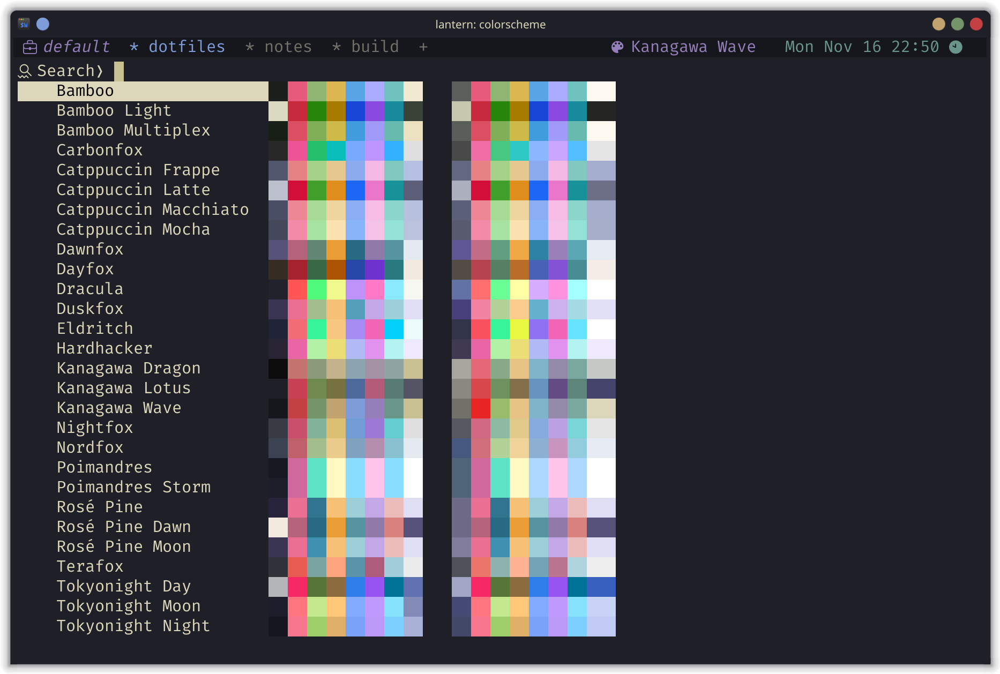
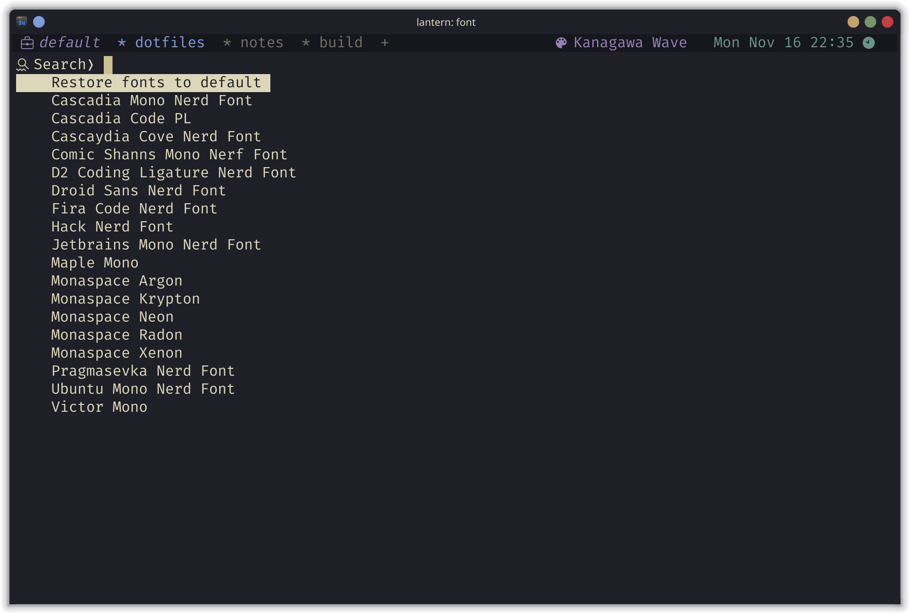
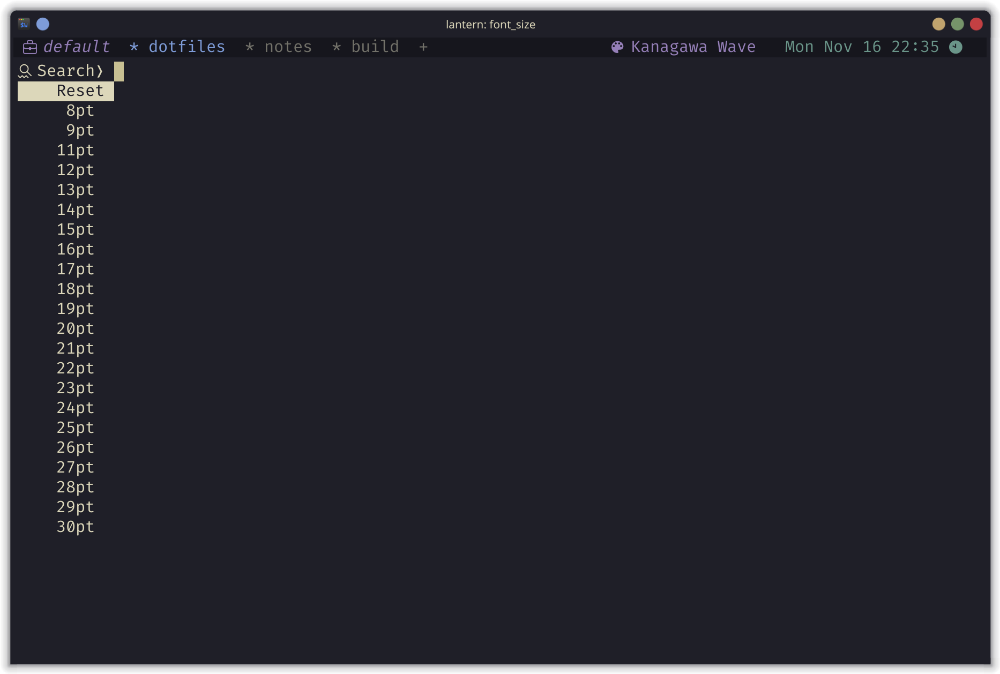
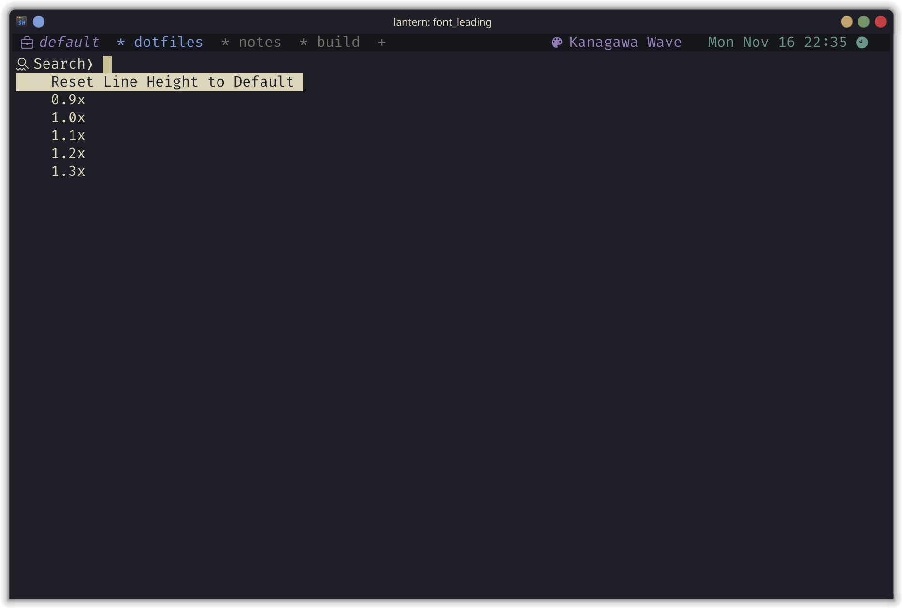
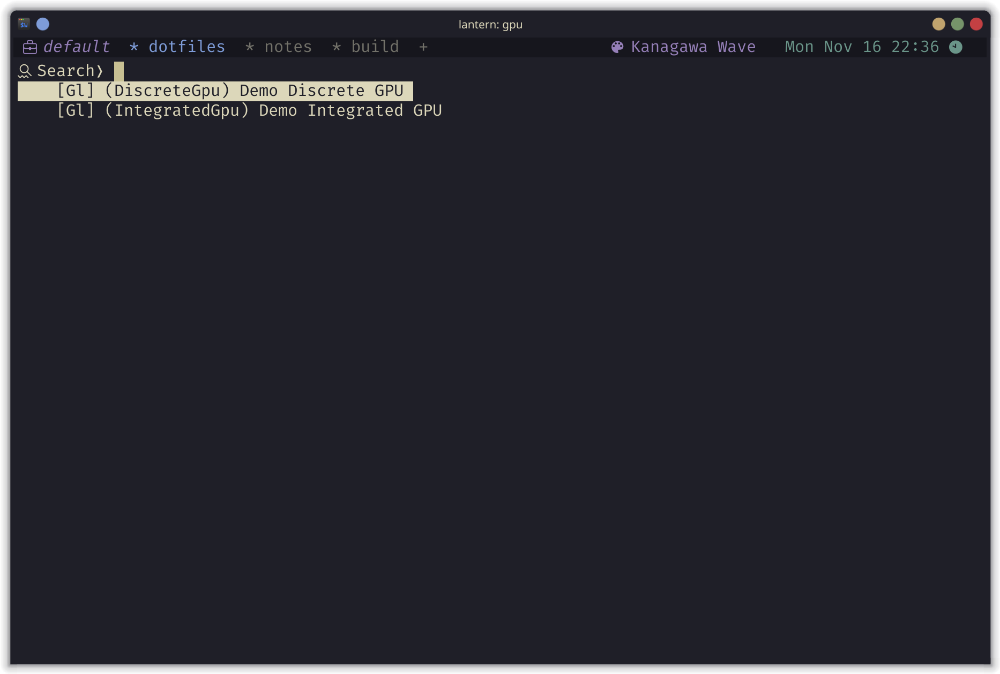
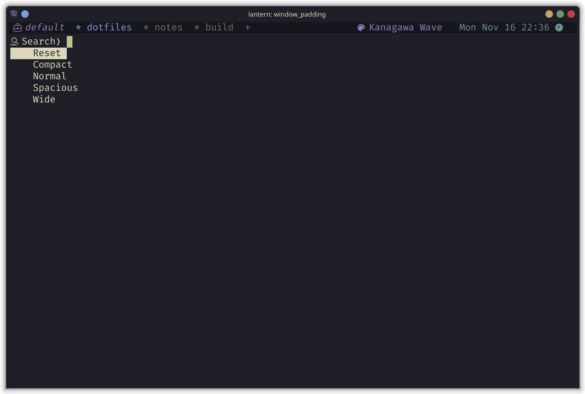
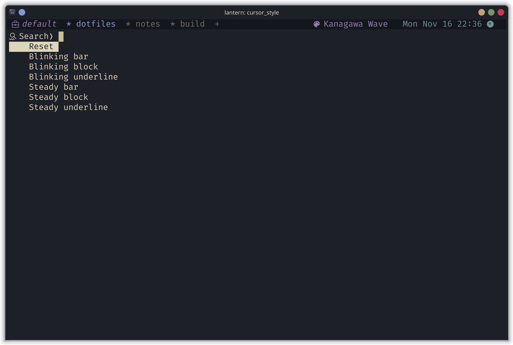
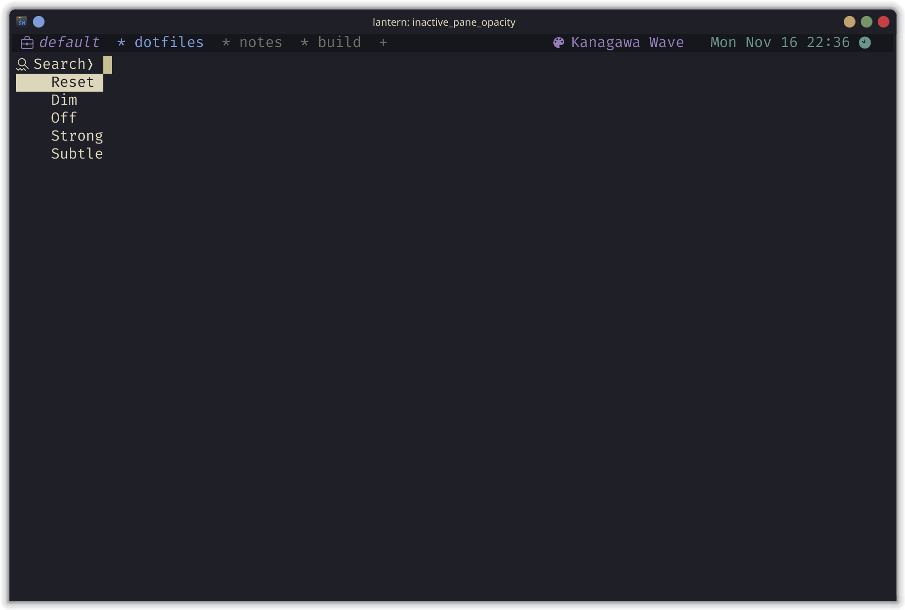
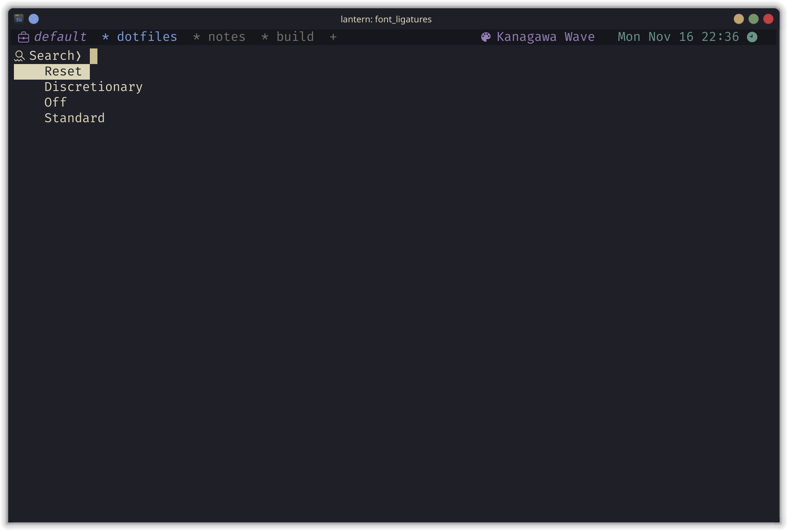
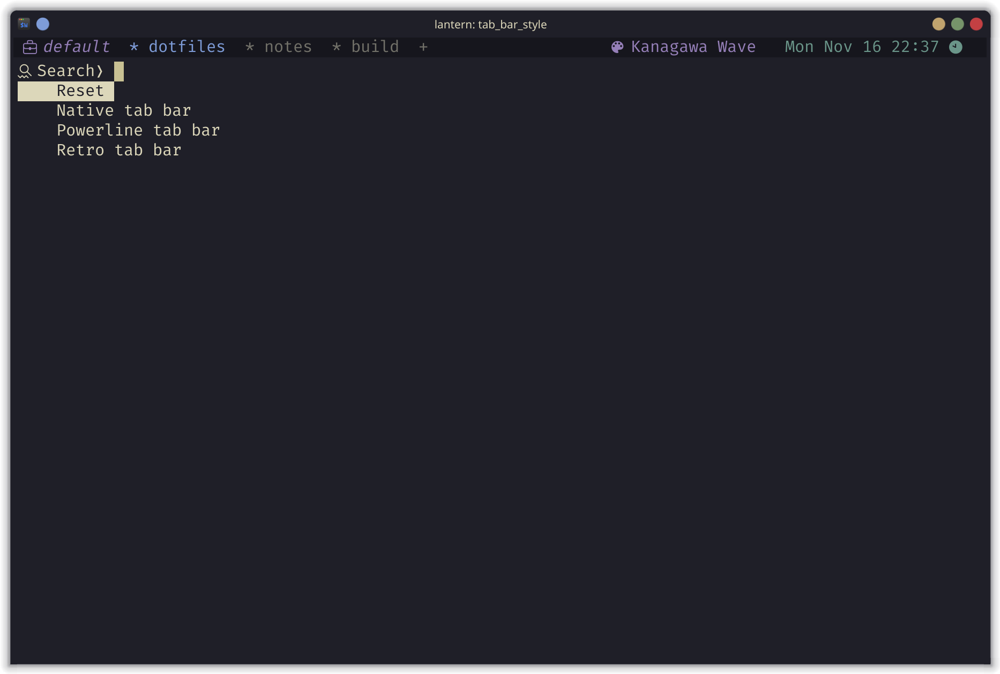

# lantern.wz [](https://github.com/sravioli/lantern.wz/releases/latest)

[](https://github.com/michaelbrusegard/awesome-wezterm)
[](https://github.com/sravioli/lantern.wz/actions/workflows/tests.yaml)
[](https://github.com/sravioli/lantern.wz/actions/workflows/lint.yaml)
[](https://coveralls.io/github/sravioli/lantern.wz)
[](../LICENSE)
[](../LICENSE-DOCS)

Pick and remember appearance settings in [WezTerm](https://wezterm.org/).

Change colors, fonts, spacing, GPU adapters, or your own presets from a
selector. A **wick** is a named selector. A **flame** supplies choices with
`glow()` and applies one with `ignite(config, ctx)`.

[Showcase](#showcase) · [Quick start](#quick-start) · [Usage](#usage) · [Configuration](#configuration) · [API reference](#api-reference) · [Troubleshooting](#troubleshooting) · [Development](#development) · [License](#license)

## Showcase

Every `lantern.light.*` function returns a key assignment that opens one selector. The bar is [mosaic.wz](https://github.com/sravioli/mosaic.wz) with `lantern.scheme`, which shows the active colour scheme. The screenshots show [kanagawa-wave](https://github.com/kanagawa-community/wezterm) (dark) and [kanagawa-lotus](https://github.com/kanagawa-community/wezterm) (light), in Fira Code Nerd Font.

### `lantern.light.colorscheme()`

Every colour scheme, with a swatch of its palette beside the name.

<picture>
  <source media="(prefers-color-scheme: light)" srcset="assets/colorscheme/light.png">
  
</picture>

<details>
<summary>The other ten selectors</summary>

### `lantern.light.font()`

Switch the font family, or restore the default fonts.

<picture>
  <source media="(prefers-color-scheme: light)" srcset="assets/font/light.png">
  
</picture>

### `lantern.light.font_size()`

Sizes in points, with a reset entry.

<picture>
  <source media="(prefers-color-scheme: light)" srcset="assets/font_size/light.png">
  
</picture>

### `lantern.light.font_leading()`

Line height as a multiple of the font height, with a reset entry.

<picture>
  <source media="(prefers-color-scheme: light)" srcset="assets/font_leading/light.png">
  
</picture>

### `lantern.light.gpu()`

The GPU adapters per backend. Needs `front_end = "WebGpu"`. The adapters in this screenshot are made up.

<picture>
  <source media="(prefers-color-scheme: light)" srcset="assets/gpu/light.png">
  
</picture>

### `lantern.light.window_opacity()`

Opaque, subtle, dim or transparent, with a reset entry.

<picture>
  <source media="(prefers-color-scheme: light)" srcset="assets/window_opacity/light.png">
  
</picture>

### `lantern.light.window_padding()`

Compact, normal, spacious or wide padding around the terminal.

<picture>
  <source media="(prefers-color-scheme: light)" srcset="assets/window_padding/light.png">
  
</picture>

### `lantern.light.cursor_style()`

A steady or blinking block, bar or underline, with a reset entry.

<picture>
  <source media="(prefers-color-scheme: light)" srcset="assets/cursor_style/light.png">
  
</picture>

### `lantern.light.inactive_pane_opacity()`

Off, subtle, dim or strong dimming of the panes you are not in.

<picture>
  <source media="(prefers-color-scheme: light)" srcset="assets/inactive_pane_opacity/light.png">
  
</picture>

### `lantern.light.font_ligatures()`

Standard, discretionary or no ligatures.

<picture>
  <source media="(prefers-color-scheme: light)" srcset="assets/font_ligatures/light.png">
  
</picture>

### `lantern.light.tab_bar_style()`

The native, retro or powerline tab bar.

<picture>
  <source media="(prefers-color-scheme: light)" srcset="assets/tab_bar_style/light.png">
  
</picture>

</details>

## Quick start

### Requirements

Requires **[WezTerm nightly with launcher-label colors (2025-05-11) or newer](https://github.com/wezterm/wezterm/commit/4a32feaa7eccda9b35a3cf5967946ce0fdd31486)**
and Git for all bundled themes and persistence.
Stable [`20240127-113634-bbcac864`](https://wezterm.org/config/lua/keyassignment/InputSelector.html)
supports choices without nightly-only fields, with persistence disabled.
GPU selection needs [`front_end = "WebGpu"`](https://wezterm.org/config/lua/config/webgpu_preferred_adapter.html).

Automatically loads [log.wz](https://github.com/sravioli/log.wz),
[memo.wz](https://github.com/sravioli/memo.wz),
[ribbon.wz](https://github.com/sravioli/ribbon.wz),
[sigil.wz](https://github.com/sravioli/sigil.wz) (every glyph),
[warp.wz](https://github.com/sravioli/warp.wz), and
[warden.wz](https://github.com/sravioli/warden.wz) through remote plugin URLs.
Dependency failure raises. Invalid options are logged and ignored. Install selected fonts yourself.
Save state outside the config directory in a writable file whose parent exists.

### Install and run

Put this in `wezterm.lua`:

```lua
local wezterm = require "wezterm"
local lantern = wezterm.plugin.require "https://github.com/sravioli/lantern.wz"
local config = wezterm.config_builder()

lantern.rekindle(config)
config.keys = {
  { key = "p", mods = "CTRL|SHIFT", action = lantern.light.colorscheme() },
}

return config
```

Press **Ctrl+Shift+P**, type to filter, and press Enter to apply a theme.
Esc cancels. The colorscheme list includes palette swatches.
In an existing config, restore after setting your base options, but before
the final return. Append the binding to your existing keys.

## Usage

### Add appearance controls

Add bindings using `lantern.light.font_size()`, `window_opacity()`, or
the other [built-in actions](../docs/api.md#lanternlight). Each returns a native
WezTerm key assignment. Creating it does not open the selector or scan flames.
Selection changes the current window's overrides. The next `rekindle` applies
saved choices to the base config, so new windows can use them too.

For font reset, set base font options first, then capture them before restore:

```lua
lantern.setup {
  default_font = {
    font = config.font,
    font_size = config.font_size,
    font_rules = config.font_rules,
    line_height = config.line_height,
  },
}
lantern.rekindle(config)
```

Font reset restores only the default-font fields you supplied. It normally
clears the saved choice, but leaves other window overrides alone.

### Build a custom selector

Register the wick after setup and before `rekindle`, so restore can find it:

```lua
lantern.add_wick("scrollback", {
  title = "Scrollback size",
  flames = {
    {
      glow = function()
        return {
          { id = "3500", label = "Compact" },
          { id = "10000", label = "Long" },
        }
      end,
      ignite = function(cfg, ctx)
        cfg.scrollback_lines = tonumber(ctx.choice.id)
      end,
    },
  },
})
```

Bind `lantern.light "scrollback"`. A flame can also be the name of a Lua
module. `glow` returns a scalar, `{ id, label? }`, or a list of choices. Use unique
string IDs. `ignite` mutates the supplied config/override table.
Legacy names `get` and `pick` are aliases for `glow` and `ignite`.

During restore, callbacks may receive only `ctx.choice`, without a window or
pane. A flame restored during config evaluation must not depend on GUI state.

### Discover preset modules when needed

```lua
lantern.add_wick("profiles", {
  flame_dirs = { wezterm.config_dir .. "/lantern/profiles" },
  restore_after = "colorschemes",
})
```

Place `.lua` flame modules that can be loaded by name in that directory.
Lantern scans it when the wick first initializes, not when the plugin loads.
A string is a directory path. A string-array spec such as `{ "fonts" }` points
beneath Lantern's bundled flames. Successful lists stay cached for the process.
Empty scans are retried. List modules explicitly if you need to control when
the available choices change.

## Configuration

### Example

Setup is optional. Call it before registering custom wicks and restoring:

```lua
lantern.setup {
  persistence = { path = wezterm.home_dir .. "/.lantern-state.json" },
  color = { opacity = 0.9 },
  defaults = { fuzzy = false },
}
```

The values above override the defaults. Lantern creates built-in wicks at
import time, so they keep their original selector settings. `defaults` applies
to wicks you register afterward.

### Options

#### Plugin settings

| Option                        | Type                                                           | Default                                 | Description                                                                                                              |
| ----------------------------- | -------------------------------------------------------------- | --------------------------------------- | ------------------------------------------------------------------------------------------------------------------------ |
| `log.enabled`                 | `boolean`                                                      | `true`                                  | Gate core diagnostics. Dependency loggers can still emit their own errors.                                               |
| `persistence.enabled`         | `boolean`                                                      | `true`                                  | Gate explicit save/clear/flush helpers. Reads and legacy migration still run.                                            |
| `persistence.path`            | `string?`                                                      | `nil`                                   | Compute `lantern-state.json` in the platform state directory when omitted.                                               |
| `persistence.legacy_path`     | `string?`                                                      | `nil`                                   | Compute `picker-state.json` beside the default state location for migration.                                             |
| `persistence.reset_behavior`  | `"clear"\|"persist"`                                           | `"clear"`                               | Clear saved reset choices, or retain them like other choices.                                                            |
| `default_font.font_size`      | `number`                                                       | `10`                                    | Font reset size in points.                                                                                               |
| `default_font.font`           | `table?`                                                       | `nil`                                   | Font reset family/style object.                                                                                          |
| `default_font.font_rules`     | `table[]?`                                                     | `nil`                                   | Font rules copied on reset.                                                                                              |
| `default_font.line_height`    | `number?`                                                      | `nil`                                   | Line-height multiplier copied on reset.                                                                                  |
| `color.opacity`               | `number`                                                       | `1`                                     | Background-layer opacity when applying a scheme. Use WezTerm's `0..1` range.                                             |
| `color.set_tab_button`        | `fun(config: table, scheme: table, ctx: Lantern.ColorContext)` | `nil`                                   | Custom new-tab button formatter. Context contains optional `name`. Failure logs and uses the built-in formatter.         |
| `defaults.title`              | `string`                                                       | `"Light a wick"`                        | Title inherited by newly registered wicks.                                                                               |
| `defaults.sort_by`            | `string`                                                       | `"id"`                                  | Choice field for the default comparator.                                                                                 |
| `defaults.fuzzy`              | `boolean`                                                      | `true`                                  | Initial fuzzy selector mode.                                                                                             |
| `defaults.description`        | `string`                                                       | `"Select a flame."`                     | Exact-mode description.                                                                                                  |
| `defaults.fuzzy_description`  | `string`                                                       | `"Search"`                              | Fuzzy-mode prompt.                                                                                                       |
| `defaults.alphabet`           | `string`                                                       | `"1234567890abcdefghilmnopqrstuvwxyz"`  | Exact-mode shortcut characters.                                                                                          |
| `defaults.icons.lantern`      | `string`                                                       | sigil `Lantern.ico`                     | Flashlight glyph, or `md_pickaxe` when the font lacks it.                                                                |
| `defaults.icons.fuzzy.ico`    | `string`                                                       | sigil `Lantern.fuzzy.ico`               | Fuzzy prompt icon.                                                                                                       |
| `defaults.icons.fuzzy.punct`  | `string`                                                       | `"❭"`                                   | Fuzzy prompt punctuation.                                                                                                |
| `defaults.icons.exact.ico`    | `string`                                                       | sigil `Lantern.exact.ico`               | Exact prompt icon.                                                                                                       |
| `defaults.icons.exact.punct`  | `string`                                                       | `":"`                                   | Exact prompt punctuation.                                                                                                |
| `defaults.comp`               | `fun(field: string): function`                                 | Built-in reset-first comparator factory | Sort reset-looking choices first, then compare field values as strings.                                                  |
| `defaults.format_choices`     | `Lantern.FormatChoices`                                        | Built-in ID/label projection            | Convert internal choice records into selector choices. See [types](../plugin/lantern/config.lua).                        |
| `defaults.format_description` | `Lantern.FormatDescription`                                    | Built-in icon/prompt formatter          | Construct exact/fuzzy prompt text.                                                                                       |
| `validate`                    | `boolean`                                                      | `true`                                  | Check options with [warden.wz](https://github.com/sravioli/warden.wz). Set `false` to skip checks and never load warden. |

#### Option validation

Options are checked against a schema when you call setup. Invalid fields are logged and ignored, and the rest still apply. Unknown keys in fixed sections log a warning.
Set `validate = false` once your configuration is stable. Lantern then never
downloads or loads warden, and uses the options exactly as written. Typos and
wrong types then go unnoticed.

```lua
lantern.setup { validate = false }
```

#### Wick settings

Pass these in `lantern.add_wick(name, spec)`. A wick keeps the selector defaults
in effect when you register it.

| Option               | Type                                                 | Default                                | Description                                                                                 |
| -------------------- | ---------------------------------------------------- | -------------------------------------- | ------------------------------------------------------------------------------------------- |
| `name`               | `string?`                                            | Registration name                      | Optional internal name. Normally omit it.                                                   |
| `flames`             | `(string\|Lantern.Flame)[]`                          | `{}`                                   | Inline flames or require-able modules.                                                      |
| `flame_dirs`         | `Lantern.FlameDir[]`                                 | `{}`                                   | Lazily scanned directories. See [discovery](#discover-preset-modules-when-needed).          |
| `title`              | `string`                                             | `defaults.title`                       | Selector title.                                                                             |
| `sort_by`            | `string`                                             | `defaults.sort_by`                     | Default comparator field.                                                                   |
| `fuzzy`              | `boolean`                                            | `defaults.fuzzy`                       | Initial search mode.                                                                        |
| `alphabet`           | `string`                                             | `defaults.alphabet`                    | Exact selector shortcuts.                                                                   |
| `description`        | `string`                                             | `defaults.description`                 | Exact-mode prompt.                                                                          |
| `fuzzy_description`  | `string`                                             | `defaults.fuzzy_description`           | Fuzzy-mode prompt.                                                                          |
| `persist`            | `boolean`                                            | `persistence.enabled` at registration  | Whether selection attempts to save this wick. Global disabled writes still take precedence. |
| `restore_after`      | `string\|string[]`                                   | `{}`                                   | Registered wick names to restore first.                                                     |
| `restore_priority`   | `number`                                             | `0`                                    | Lower values sort first among unrelated wicks. Dependencies win.                            |
| `comp`               | `fun(a: Lantern.Choice, b: Lantern.Choice): boolean` | Computed from `defaults.comp(sort_by)` | Comparator for formatted choices.                                                           |
| `format_choices`     | `Lantern.FormatChoices`                              | `defaults.format_choices`              | Choice projection callback.                                                                 |
| `format_description` | `Lantern.FormatDescription`                          | `defaults.format_description`          | Prompt-format callback.                                                                     |

### Behavior and precedence

Each setup call merges fresh defaults with your options using Warp's deep
`"force"` merge. Maps merge and lists replace. Lantern does not check unknown
settings against a schema. Existing wicks keep their selector settings. Color and state
helpers read the current settings when they run.

State defaults to `%LOCALAPPDATA%\wezterm` (then `%APPDATA%\wezterm`) on Windows,
or `$XDG_STATE_HOME/wezterm` (then `$HOME/.local/state/wezterm`) elsewhere.
If those are unavailable, it falls back to `.`, never to `wezterm.config_dir`.
Inspect `lantern.state.path()` and create its parent directory yourself.
Memo's file writes do not create it. Prefer an explicit writable path outside
the config directory to avoid reload loops.

`rekindle` rereads disk and applies saved flames to the supplied config.
Window overrides still take precedence over base config values.
Lantern restores dependencies first, then orders unrelated entries by
priority and name. A cycle produces a warning without stopping the whole restore.
Turning persistence off does not prevent restore or legacy migration. Omit
`rekindle` if you do not want either.

Lantern recognizes a reset by ID `"reset"` or label `"Reset"`, ignoring case.
Legacy picker state can migrate when active state is empty. Module names
starting `picker.assets.` become `lantern.flames.`. GPU records keep the adapter
descriptor so restore does not need to enumerate again. Old vendor-only records
enumerate once to upgrade. Reopen the GPU picker after changing hardware.

## API reference

The [API reference](../docs/api.md) lists every function, method, and value
with its parameters and return values. It is generated from the LuaLS
annotations in `plugin/`, so it matches the code. It has these sections:

- [lantern](../docs/api.md#lantern)
- [lantern.light](../docs/api.md#lanternlight)
- [lantern.flames](../docs/api.md#lanternflames)
- [lantern.config](../docs/api.md#lanternconfig)
- [lantern.color](../docs/api.md#lanterncolor)
- [lantern.state](../docs/api.md#lanternstate)
- [Lantern.Flame](../docs/api.md#lanternflame)
- [Lantern.Wick](../docs/api.md#lanternwick)
- [Lantern.WickSpec](../docs/api.md#lanternwickspec)
- [Lantern.ColorConfig](../docs/api.md#lanterncolorconfig)
- [Lantern.DefaultConfig](../docs/api.md#lanterndefaultconfig)
- [Types](../docs/api.md#types)

`?` marks optional arguments or nullable results. Module calls use `.`.
Wick instance calls use `:`. An action result is a WezTerm key assignment.

### Selectors and helpers

Immediate discovery can yield, so use `flame_dirs` when registering wicks
during config loading. Lantern logs flame-load failures during initialization
and skips those flames, but `ignite` errors can propagate. Make sure custom
callbacks are safe in the context where they run.

### Saved state

`state.get` can return a GLOBAL-backed proxy. Treat it as read-only.
The normalized outer tables from `all` may still contain a nested adapter proxy.

## mosaic integration

lantern ships `lantern.scheme` for the
[mosaic.wz](https://github.com/sravioli/mosaic.wz) status bar. It shows the
active colour scheme: the window override when one is set, else the
configured scheme. mosaic reads the module only when a layout names it.

```lua
mosaic.setup {
  layout = { right = { { "lantern.scheme", "clock" } } },
  options = {
    ["lantern.scheme"] = { icon = false }, -- optional: hide the glyph (default: sigil's Palette)
  },
}
```

## Troubleshooting

### A selection is not restored

Register custom wicks before `rekindle`, check that the state parent directory
exists, and check the debug overlay (**Ctrl+Shift+L**). Removed flame modules
or changed choice IDs can make old records stale. Clear the affected wick's
state instead of deleting unrelated saved choices.

### The font or GPU does not change

Install the selected font. GPU choice depends on GUI enumeration and the
active graphics backend. Creating a picker action alone does not enumerate.
`best()` does enumerate, so avoid it during config loading if unnecessary.

Update plugins with `wezterm.plugin.update_all()` from the debug overlay and
reload. Report [issues](https://github.com/sravioli/lantern.wz/issues) with
the wick/flame, sanitized state, plugin revision, and WezTerm build.

## Development

### Local checkout

Load the working tree directly, so edits take effect on the next config
reload without a commit or a plugin update. Adjust the path to your clone:

```lua
local wezterm = require "wezterm"
local root = wezterm.home_dir .. "/path/to/lantern.wz/plugin/"
package.path = root .. "?.lua;" .. root .. "?/init.lua;" .. package.path
local lantern = require "lantern.api"
```

Its four dependencies still resolve through their remote URLs. Keep them
installed for offline use.

### Editor support

Follow the [wezterm-types setup](https://github.com/DrKJeff16/wezterm-types):

```lua
---@type Lantern
local lantern = wezterm.plugin.require "https://github.com/sravioli/lantern.wz"
```

The [published definitions](https://github.com/DrKJeff16/wezterm-types/blob/main/lua/wezterm/types/plugins/lantern.lua)
cover the main API, but omit restore ordering, saved GPU descriptors,
`color.set_tab_button`, and state reload helpers. Consult the
[core](../plugin/lantern/core.lua), [config](../plugin/lantern/config.lua), and
[state](../plugin/lantern/state.lua) annotations for this revision.

### Checks and contributions

From the repository root, with Lua 5.4 and the named tools installed:

```sh
busted --verbose
luacheck plugin spec
selene --display-style=quiet plugin
stylua --check plugin spec
```

The suite uses mocked dependencies and GUI APIs. Follow the
[contribution guide](contributing.md), preserve compatible defaults, and use
Conventional Commits.

## License

Code: [GNU GPL v2](../LICENSE). Documentation:
[CC BY-NC 4.0](../LICENSE-DOCS). Preserve source attribution, including the
font reset contribution credited to `sravioli, akthe-at`.
